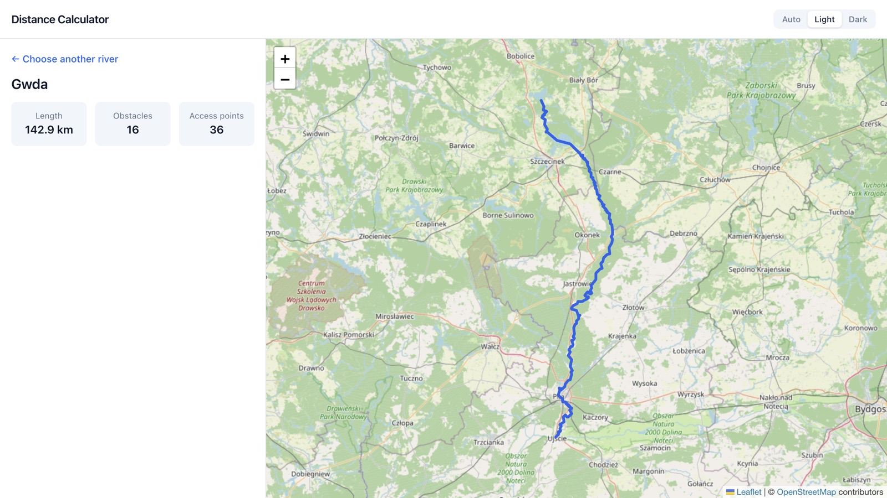

# Distance Calculator

[](https://github.com/jbryn/distance-calculator/actions/workflows/ci.yml)

A web app for planning kayaking trips. Pick a river and see it on a map; the next steps let you pick a start and a finish and get the distance along the river, following every bend, with the weirs, dams and landing places on the way.



## Status

Work in progress, tracked in the [Kayak river tool v1](https://github.com/jbryn/distance-calculator/milestone/1) milestone with one issue per pull request.

| | |
|---|---|
| **Works now** | Search 15 Polish rivers and show one on the map with its length, obstacles and access points. Light and dark themes; desktop and phone layouts. The API can already measure any section between two points. |
| **Next** | Click a start and a finish on the map to measure a section; trip details (km or miles, paddling time, obstacles on the route); shareable links; GPX export; Docker and a public deployment. |

## How it works

1. **River data comes from OpenStreetMap.** A river there is a list of separate pieces. For each river on offer, the pieces and the features along it (weirs, dams, locks, bridges, landing places) are downloaded once through the Overpass API and saved in the repository. The app never waits on an outside service.
2. **The API joins the pieces into one line** from source to mouth, refuses rivers whose map data has gaps, and places each feature on the line by its distance from the source.
3. **A section is measured along that line.** Both points are snapped to the nearest place on the river, and the distance between them is the length of the line in between.
4. **The web client** searches the rivers, draws the chosen one on a Leaflet map with OpenStreetMap tiles, and shows its details.

The measurements are checked against official river kilometrage from IMGW-PIB, the Polish hydrological service: on 33 stretches between gauging stations, 30 are within the reference tolerance (3%, or 6% on difficult reaches) and 21 within 0.5%.

## Tech stack

| Part | Technologies |
|---|---|
| API (`api/`) | PHP 8.1+, Slim 4, PHP-DI, Guzzle (only for refreshing river data) |
| Web client (`client/`) | Vue 3, TypeScript, Pinia, Leaflet, Tailwind CSS, Vite |
| Tests | PHPUnit, Vitest, Cypress |
| Code quality | PHPStan (strictest level), PHP-CS-Fixer, ESLint, Prettier |
| CI | GitHub Actions: tests on PHP 8.1 and 8.4, linting, static analysis and end-to-end tests on every pull request |

## Quick start

You need PHP 8.1 or newer with Composer, and Node.js 22 or newer.

```bash
git clone https://github.com/jbryn/distance-calculator.git
cd distance-calculator
```

Start the API (terminal 1):

```bash
cd api
composer install
composer start          # http://localhost:8080
```

Start the web client (terminal 2):

```bash
cd client
npm install
npm run dev             # http://localhost:5173
```

Open http://localhost:5173 and pick a river.

## Project structure

```
api/
  data/          saved river data: the catalogue of rivers and the OpenStreetMap responses
  src/
    Controller/  HTTP endpoints
    Geo/         points and lines on the globe: distances, snapping, sections
    Overpass/    client for the OpenStreetMap Overpass API, with a file cache
    River/       joining pieces into a river, features along it, the catalogue
  bin/           command for refreshing the river data
  tests/
client/
  src/
    api/         typed API client
    components/  Vue components
    composables/ search and theme logic
    stores/      Pinia store for the selected river
  cypress/       end-to-end tests
docs/            API reference
```

## Development

| Command | Where | What it does |
|---|---|---|
| `composer test` | `api/` | PHPUnit tests |
| `composer lint` | `api/` | PHPStan and a code style check |
| `composer format` | `api/` | Fixes PHP code style |
| `composer rivers:fetch` | `api/` | Downloads fresh river data from OpenStreetMap (see [`api/data/README.md`](api/data/README.md)) |
| `npm run test` | `client/` | Vitest unit tests (`npm run test:coverage` for a coverage report) |
| `npm run e2e` | `client/` | Cypress end-to-end tests; both servers from the quick start must be running. `npm run e2e:open` runs them interactively. Map tiles come from a fixture, not from OpenStreetMap. |
| `npm run lint` | `client/` | ESLint |
| `npm run format` | `client/` | Prettier |

### Configuration

Both parts work with their defaults. To change them, copy `api/.env.example` to `api/.env` and `client/.env.example` to `client/.env`.

| File | Variable | Default | Purpose |
|---|---|---|---|
| `api/.env` | `APP_DEBUG` | `false` | Include error details in API error responses |
| `api/.env` | `CORS_ORIGIN` | `http://localhost:5173` | Web client origin allowed to call the API |
| `api/.env` | `OVERPASS_OFFLINE` | `true` | Answer only from the saved river data. Turned off only to fetch new data |
| `api/.env` | `OVERPASS_CACHE_DIR` | `api/data/overpass` | Where the river data is saved |
| `api/.env` | `OVERPASS_ENDPOINTS` | two public servers | When fetching: Overpass servers to try, comma-separated |
| `api/.env` | `OVERPASS_CACHE_TTL` | `2592000` (30 days) | When not offline: how long saved data counts as fresh |
| `client/.env` | `VITE_API_URL` | `http://localhost:8080` | Address of the API |

If you run either part on a different port, update the matching variable on the other side.

## Documentation

- [API reference](docs/api.md): endpoints, responses and errors
- [River data](api/data/README.md): which rivers are offered, the saved files, and how to add or refresh a river
- [Test fixtures](api/tests/fixtures/README.md): the reference distances from IMGW-PIB and a river kept as a bad example

## Data sources

- Map data and map tiles © [OpenStreetMap](https://www.openstreetmap.org/copyright) contributors, available under the Open Database License.
- Reference river kilometrage: Instytut Meteorologii i Gospodarki Wodnej – Państwowy Instytut Badawczy (IMGW-PIB).
